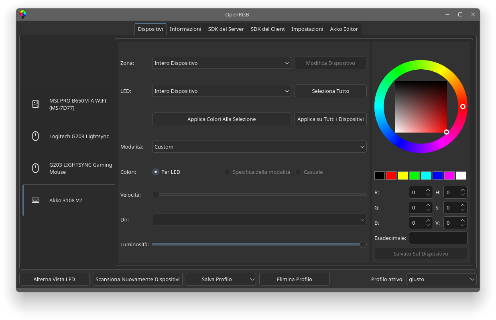
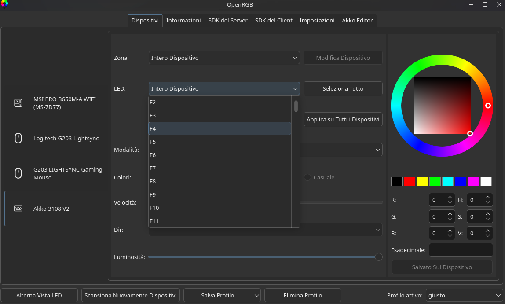
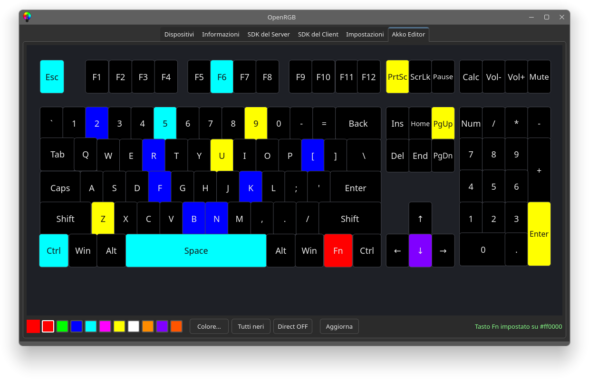

# Akko-OpenRGB-Plugin

[](LICENSE)
[](https://openrgb.org)

OpenRGB plugin (Plugin API v5) that adds support for the **Akko 3108 V2**
keyboard (Akko Ducky 3108S RGB, Sonix chip, USB `0C45:762B`) and an
**"Akko Editor"** tab with the keyboard drawn on screen: click a key, pick a
colour, done.

Works on **OpenRGB 1.0 and 1.1** (both use Plugin API v5) — also on stock
builds that do not ship any driver for this keyboard.





---

## Supported devices

| Keyboard | Chip | USB ID | Status |
|---|---|---|---|
| **Akko 3108 V2** (Akko Ducky 3108S RGB, "Keyboard H / H3108 V2") | Sonix | `0C45:762B` | ✅ tested on real hardware (all 108 keys + effects) |

OpenRGB already lists some other Akko boards (e.g. the Royuan-based
*Akko 3068B Plus*). This plugin covers a **different** chip, which is not in
OpenRGB. Other keyboards with the same `0C45:762B` ID *might* work too — if you
try one, please open an issue.

> **Why isn't it in OpenRGB's own "Supported Devices" list?**
> That list is filled by detectors compiled into OpenRGB itself, and the plugin
> API (v5) has no hook to add one. The plugin therefore finds the keyboard on
> its own and registers it as a virtual device. It appears in the **Devices**
> tab and in the **Akko Editor** tab, exactly like a native one.

---

## Features

- **Akko Editor** tab: keyboard drawn with real key proportions (108 keys),
  10-colour palette + colour picker, "All black" reset. Key labels stay in
  English like the keycaps.
- **Per-key colours** (Custom mode) and **19 effects** (Static, Breathing,
  Spectrum Cycle, Color Wave, Reactive, Ripple, Starlight, Hurricane…) from the
  standard OpenRGB Devices page.
- Readable LED names in the Devices page (e.g. *Ctrl destro*, *Alt sinistro*,
  *Freccia su*, *Tastierino 7*).
- Bundled HID driver (EVision V1 protocol): scans the USB bus itself, opens the
  LED interface (`interface 1`, usage page `0xFF1C`), logs every step to the
  OpenRGB log.
- Auto-skips registration if OpenRGB already detected the keyboard (no
  duplicate devices).
- **Fully standalone build**: the Plugin SDK headers are vendored in
  [`sdk/`](sdk/); no OpenRGB source tree needed.

### What's new in 1.1.0

- ✅ **Fixed the key map**: *Fn*, *right Ctrl*, *right Win*, *right Alt*,
  *↑*, the numpad bottom rows, *Num Enter* and *Num0/Num.* were wrong
  (the LED slots were shifted). Now all 108 keys light up correctly.
- Editor: fixed unreadable label colour on bright keys, labels that fitted
  badly in narrow keys, misaligned top-right keys (Calc, Vol-, Vol+, Mute);
  compact numpad labels.
- Readable LED names in the Devices page.
- Verified against OpenRGB **1.1**.

Protocol and key-map details: [`docs/PROTOCOL.md`](docs/PROTOCOL.md).

---

## Install (Linux, prebuilt)

1. Download `Akko-OpenRGB-Plugin-linux-x86_64.zip` from the
   [Releases](../../releases) page and unzip it.
2. `bash install.sh` (copies `libAkkoKeyboardPlugin.so` to
   `~/.config/OpenRGB/plugins/`, keeping a backup of the old one).
3. Restart OpenRGB → **Settings → Plugins** → tick **Enabled** on the Akko
   plugin.
4. Use the **Akko Editor** tab, or pick **Akko 3108 V2** in the Devices tab.

The prebuilt `.so` needs Qt6 and glibc ≥ 2.35 (Ubuntu 22.04+, Debian 12+,
Fedora 36+, Arch/CachyOS/Manjaro…). On older distros, or with a Qt5 build of
OpenRGB, build from source.

If the keyboard does not show up, check:

```bash
lsusb | grep 0c45          # keyboard plugged in?
ls -la /dev/hidraw*        # permissions
openrgb --startminimized   # watch the [Akko…] log lines
```

---

## Build from source

Requirements: CMake ≥ 3.16, a C++17 compiler, Qt6 (or Qt5 with
`-DOPENRGB_PLUGIN_QT6=OFF`), `hidapi` (Linux: `hidapi` + pkg-config; Windows:
vendored in `sdk/hidapi/`).

```bash
cmake -S . -B build -DCMAKE_BUILD_TYPE=Release
cmake --build build -j"$(nproc)"
cp build/libAkkoKeyboardPlugin.so ~/.config/OpenRGB/plugins/
```

Build against the **same Qt major version** as your OpenRGB (the Arch/CachyOS
package uses Qt6). On Windows use **MSVC** (same ABI as the official OpenRGB);
the GitHub Actions workflow in
[`.github/workflows/release-builds.yml`](.github/workflows/release-builds.yml)
builds both the Linux `.so` and the Windows `.dll` when a `v*` tag is pushed.
The Windows build is untested on real hardware: consider it beta.

---

## Project layout

```
Akko-OpenRGB-Plugin/
├── CMakeLists.txt
├── src/
│   ├── AkkoKeyboardPlugin.*       plugin entry point (API v5)
│   ├── AkkoHidDetector.*          USB scan + virtual device (modes, zones, LED names)
│   ├── AkkoDeviceBridge.*         EVision V1 packets, LED→slot map
│   ├── KeyboardCanvas.*           keyboard drawing
│   ├── KeyboardEditorWidget.*     "Akko Editor" page
│   ├── KeyboardLayout.h           key positions and labels
│   └── metadata.json
├── sdk/                           vendored OpenRGB Plugin SDK + nlohmann/json + hidapi (Windows)
├── packaging/                     install scripts and instructions for the release ZIPs
├── docs/PROTOCOL.md               protocol, packets, slot map
└── docs/img/                      screenshots
```

---

## In italiano

Plugin per **OpenRGB 1.0 e 1.1** che fa funzionare la tastiera **Akko 3108 V2**
(Akko Ducky 3108S RGB, chip Sonix, USB `0C45:762B`): colori tasto per tasto,
19 effetti e una scheda **Akko Editor** con la tastiera disegnata.

**Installazione (Linux):** scarica lo ZIP dalle Release, estrai, esegui
`bash install.sh`, riavvia OpenRGB e abilita il plugin da
*Impostazioni → Plugin*.

**Perché non compare nell'elenco "Dispositivi Supportati" di OpenRGB?** Quella
lista contiene solo i rilevatori compilati dentro OpenRGB e un plugin non può
aggiungerne uno: la tastiera compare comunque nella scheda *Dispositivi* e in
*Akko Editor*.

---

## Credits

Made by **[zimu96](https://github.com/zimu96)**, who owns the keyboard, did the
USB captures and tested everything on real hardware, **together with
[Claude](https://claude.com/claude-code) (Anthropic)** as AI coding assistant:
protocol reverse engineering, driver, editor, documentation. An earlier
version of the plugin was built with another AI assistant.

Thanks to the [OpenRGB](https://openrgb.org) project and its Plugin SDK, and to
the [SN32 QMK](https://github.com/SonixQMK/qmk_firmware) community for the
Sonix documentation.

## License

[GPL-2.0-or-later](LICENSE), like OpenRGB. `sdk/hidapi/` is BSD-3-Clause,
`sdk/nlohmann/` is MIT.
